# 🎥 Video demostrativo
**YouTube:** PENDIENTE DE PUBLICAR. Colocar aquí el enlace del video (máximo 10 minutos, con fecha/hora, rostro y voz) antes de entregar.

# Asignación 4 · Semana 9 — Auditoría y hardening de red basado en CIS Benchmark

**Institución:** ITLA · **Modalidad:** Individual · **Laboratorio:** GNS3, Ubuntu Server, Cisco IOS 12.4 y FortiOS 7.4.13.

## Propósito
Evaluar de forma automatizada controles de configuración segura en un router Cisco (R1), un switch Cisco (SW1) y un firewall FortiGate (FG1), aplicar medidas de endurecimiento seleccionadas y documentar la comparación antes/después, las pruebas y las limitaciones encontradas.

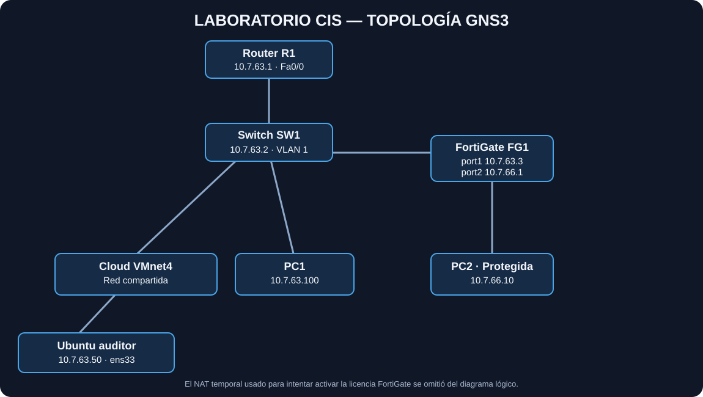

### Topología y direccionamiento
| Equipo | Interfaz / función | Dirección |
|---|---|---|
| R1-CIS | Fa0/0, red de gestión | 10.7.63.1/24 |
| SW1-CIS | VLAN 1, gestión | 10.7.63.2/24 |
| FG1-CIS | port1, red LAN | 10.7.63.3/24 |
| FG1-CIS | port2, red protegida | 10.7.66.1/24 |
| Ubuntu Server | ens33, auditor | 10.7.63.50/24 |
| PC1 | LAN | 10.7.63.100/24 |
| PC2 | segmento protegido | 10.7.66.10/24 |

**Enlaces:** R1 Fa0/0 → SW1 Fa1/0; SW1 Fa1/1 → Cloud/VMnet4; SW1 Fa1/2 → PC1; SW1 Fa1/3 → FG1 port1; FG1 port2 → PC2. Se incluyó un NAT temporal conectado a otro adaptador del firewall para intentar registrar su licencia; esa conectividad no se completó.

## Herramienta y procedimiento
1. Ejecutar [auditoria_cis.py](scripts/auditoria_cis.py) desde Ubuntu (modo **solo lectura**), con SSH y Pexpect, y conservar los informes iniciales.
2. Ejecutar [aplicar_cis.py](scripts/aplicar_cis.py): solicita escribir `APLICAR` por dispositivo, configura controles seleccionados y verifica cambios inmediatamente.
3. Ejecutar nuevamente el auditor, conservando por separado el **antes** y el **después**.
4. Comprobar SSH, interfaces y conectividad; guardar evidencias.

No se usó CIS-CAT oficial. Esta es una **herramienta propia que revisa controles seleccionados**, no una certificación integral de cumplimiento. No se adjudican identificadores oficiales de recomendaciones sin cotejo directo con la edición del benchmark correspondiente.

## Controles evaluados y justificación
| Equipo | Control | Comprobación | Justificación |
|---|---|---|---|
| Cisco R1 y SW1 | SSH v2 | `show ip ssh` | Evita administración en texto claro |
| Cisco R1 y SW1 | Tiempo de autenticación SSH ≤ 60 s | `show ip ssh` | Reduce ventanas de intento de autenticación |
| Cisco R1 y SW1 | Máximo 3 intentos SSH | `show ip ssh` | Limita intentos repetidos |
| Cisco R1 y SW1 | VTY solo SSH | `show running-config | section line vty` | Excluye Telnet de acceso remoto |
| FortiGate | Sesión administrativa inactiva ≤ 5 min | `admintimeout` | Reduce exposición de sesiones desatendidas |
| FortiGate | Bloqueo tras ≤ 3 fallos | `admin-lockout-threshold` | Limita ataques por fuerza bruta |
| FortiGate | Bloqueo ≥ 300 s | `admin-lockout-duration` | Desincentiva intentos repetidos |
| FortiGate | SSHv1 deshabilitado | `admin-ssh-v1` | Evita un protocolo obsoleto |
| FortiGate | Telnet administrativo deshabilitado | `admin-telnet` | Evita credenciales en texto claro |
| FortiGate | Cifrado fuerte | `strong-crypto` | **No verificado**: el parámetro no fue obtenido por el auditor |

**Correcciones automatizadas y comprobadas:** `ip ssh time-out 60` en R1 y SW1; `set admin-lockout-duration 300` y `set admin-telnet disable` en FG1. Algunas otras configuraciones ya se encontraban en estado deseado antes de ejecutar el script.

## Resultados documentados
| Dispositivo | Inicial: cumple / no cumple / no verificado | Posterior: cumple / no cumple / no verificado |
|---|---:|---:|
| Router R1 | 3 / 1 / 0 | 4 / 0 / 0 |
| Switch SW1 | 3 / 1 / 0 | 4 / 0 / 0 |
| FortiGate FG1 | 3 / 2 / 1 | 5 / 0 / 1 |
| **Total** | **9 / 4 / 1** | **13 / 0 / 1** |

Ver [resumen de evidencias](informes/RESUMEN_RESULTADOS.md). Estas cifras fueron observadas en las salidas del auditor; el control de cifrado fuerte sigue pendiente, y no es correcto afirmar «100 % CIS».

## Pruebas realizadas
- Ubuntu → R1, SW1 y FG1: ping exitoso, **0 % de pérdida**.
- PC1 → R1, SW1 y FG1: **5/5 respuestas** por destino.
- PC2 ↔ FortiGate port2: conectividad ICMP directa en ambos sentidos.
- Ubuntu → PC2 (`10.7.66.10`): **0/4 respuestas** incluso con ruta `via 10.7.63.3`; **no se atribuye automáticamente a un bloqueo correcto**.
- FG1: política `AUDITOR-HACIA-RED-PROTEGIDA` configurada para permitir PING entre objetos específicos, pero **el filtrado extremo a extremo no quedó demostrado**.

### Limitaciones y honestidad de la evidencia
**La licencia FortiGate-VM figura `Invalid`.** Aunque el CLI admitió la configuración de la política y el hardening administrativo, no se puede afirmar que la política de filtrado esté funcionando. La evaluación de `strong-crypto` quedó **NO VERIFICADO**. Los dispositivos Cisco usan IOS 12.4 en un entorno de laboratorio y el cliente SSH precisó algoritmos antiguos por compatibilidad; **no reutilizarlos en producción**.

## Galería de capturas reales del laboratorio
> Las imágenes provienen de las consolas y pruebas realizadas. **Pendiente: transferir los archivos PNG a la carpeta `imagenes/` de este repositorio.** Si aún no se ven, descargue el ZIP de capturas preparado y súbalas conservando los nombres.

### Topología y administración
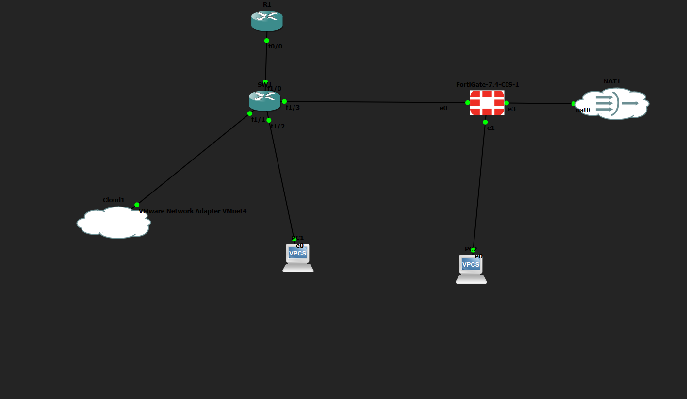
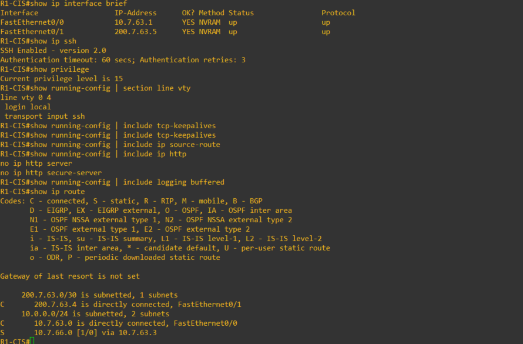
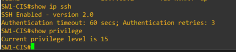
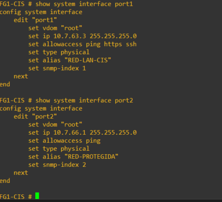
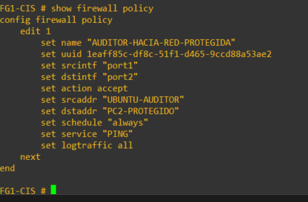

### Auditoría inicial
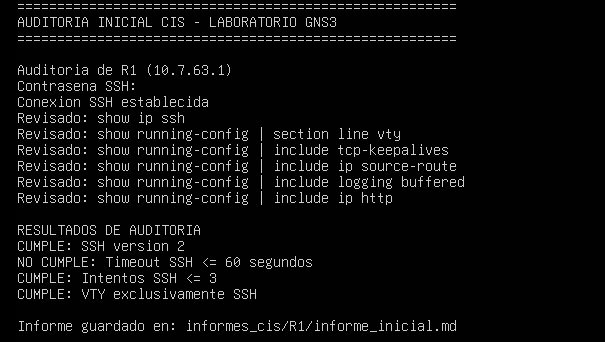
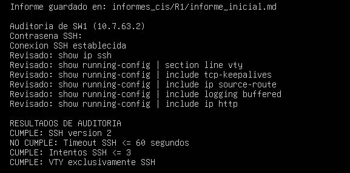
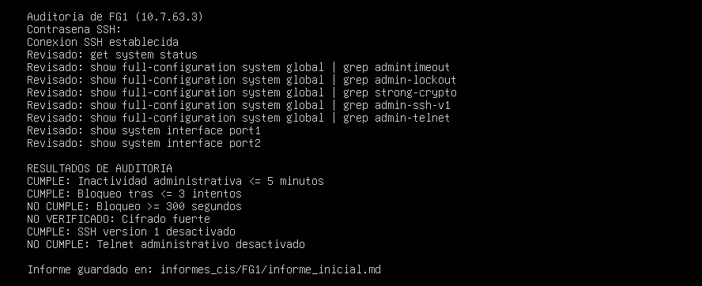

### Aplicación automatizada
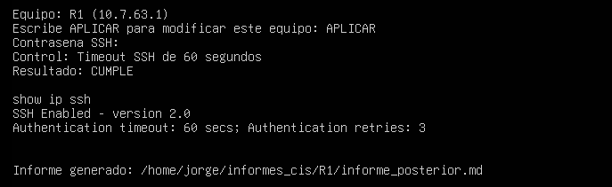
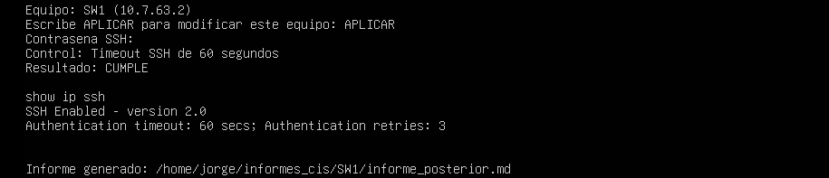
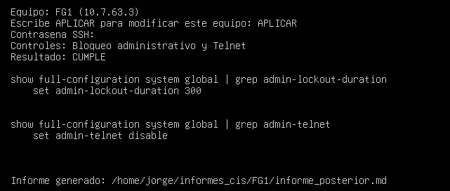

### Auditoría final
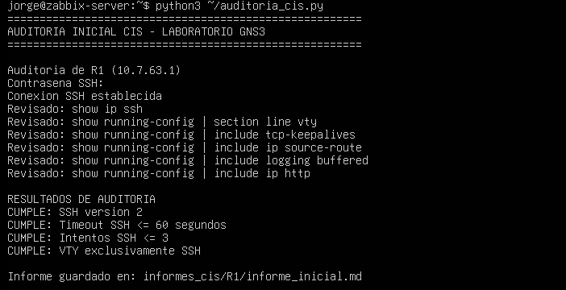
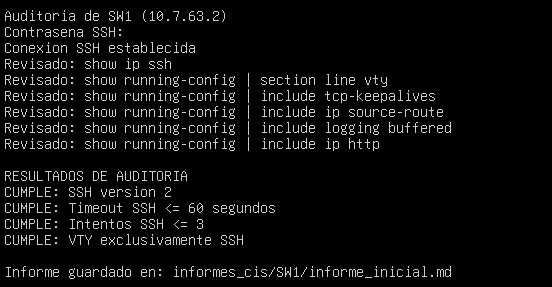
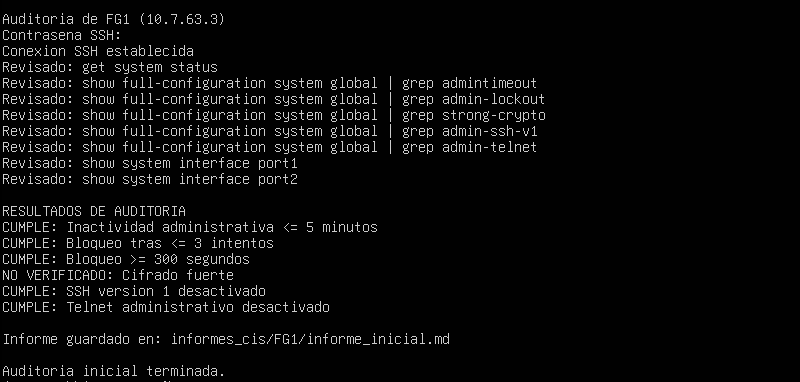
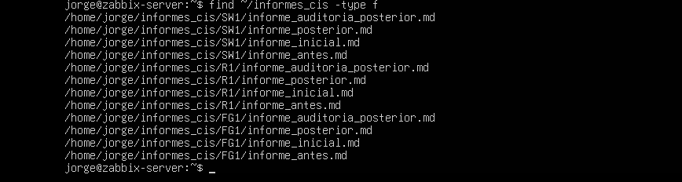

### Verificación de conectividad
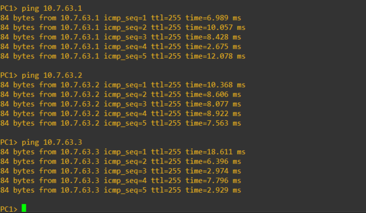
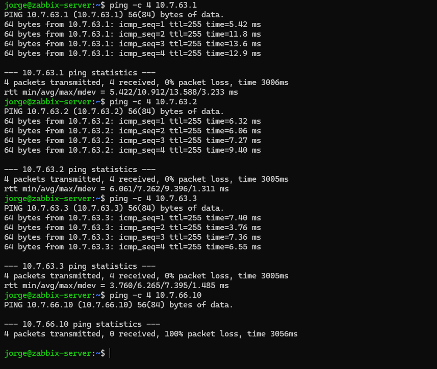
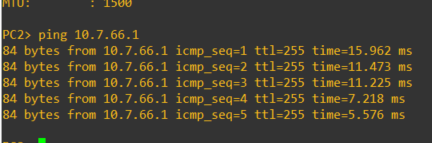
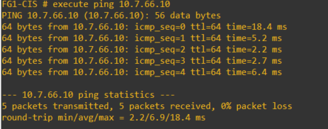
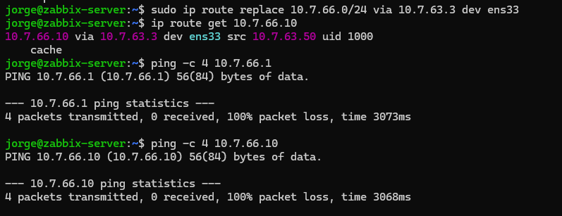

## Estructura de documentación
- `scripts/` — códigos de auditoría de solo lectura y aplicación automatizada.
- `informes/` — resumen contrastado, y espacio para los informes reales obtenidos en Ubuntu.
- `configuraciones/` — capturas/archivos de configuración **depurados** sin contraseñas ni hashes.
- `imagenes/` — capturas de topología, SSH, auditorías, pruebas y hardening.
- `diagramas/` — diagrama SVG editable/visualizable.
- `documentacion/` — metodología, pruebas y pendientes de evidencia.
- `entrega/` — indicaciones para el TXT final y el enlace del video.

## Fuentes de referencia
- [CIS Benchmarks](https://www.cisecurity.org/cis-benchmarks)
- [CIS para Cisco](https://www.cisecurity.org/benchmark/cisco) (IOS 12.4, consultar versión archivada pertinente)
- [CIS FortiGate 7.4.x](https://www.cisecurity.org/benchmark/fortinet)
- [Fortinet — referencia CLI system global 7.4.x](https://docs.fortinet.com/document/fortigate/7.4.8/cli-reference/339914554/config-system-global)

> **Seguridad al publicar:** nunca subir contraseñas, hashes tipo 5, llaves privadas, tokens ni configuraciones sensibles sin depurar. Se incluyen notas sobre qué artefactos todavía deben exportarse directamente desde Ubuntu o los equipos.

## Galería de evidencias reales
> Las imágenes se mostrarán después de subir los PNG a `imagenes/`. [Ver índice completo de capturas](imagenes/README.md).

| Auditoría inicial | Auditoría posterior |
|---|---|
|  |  |
|  |  |
|  |  |

**Prueba de aplicación:** [R1](imagenes/hardening_automatico_R1.png) · [SW1](imagenes/hardening_automatico_SW1.png) · [FG1](imagenes/hardening_automatico_FG1.png).
